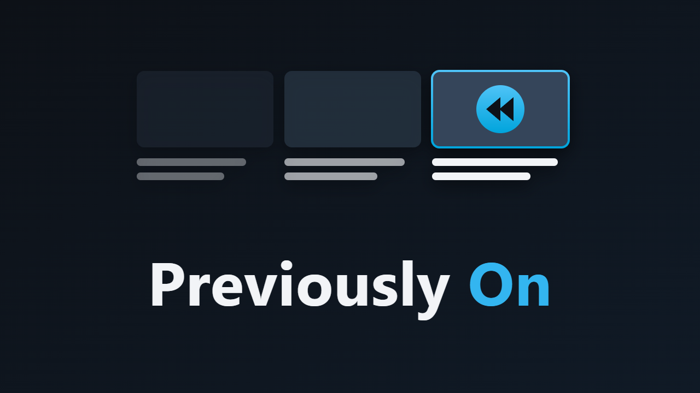

# Previously On – Jellyfin-Plugin (Jellyfin 12.x)



Wer eine Serie nach längerer Pause fortsetzt, sieht vor dem Start der Episode „Was bisher geschah“: die Beschreibungen der letzten Episoden, mit Vorschaubild. Beginnt eine neue Staffel, steht davor die Beschreibung der vorigen Staffel.

- **Rein lokal:** Die Texte sind die Episoden- und Staffelbeschreibungen, die Jellyfin beim Bibliotheksscan ohnehin gespeichert hat. Das Plugin fragt keinen externen Dienst ab und braucht keinen API-Schlüssel.
- **Spoilerfrei:** Gezeigt werden nur Episoden vor der, die gleich startet. Die Beschreibung der kommenden Episode bleibt weg.
- **Pro Nutzer:** Die Pause zählt ab dem Zeitpunkt, an dem der jeweilige Nutzer zuletzt etwas von der Serie abgespielt hat.
- **Hält die Wiedergabe an, bis du weitermachst:** Der Player lädt erst, wenn du „Weiter zur Episode“ wählst. Enter, Escape und die Zurück-Taste machen ebenfalls weiter. Mit den Pfeiltasten scrollst du durch den Text.
- Wer direkt weiterschaut, etwa durch automatisches Abspielen der nächsten Episode, sieht nichts davon.

## Wann erscheint der Rückblick?

Alle Bedingungen müssen erfüllt sein:

1. Es startet eine Episode einer Serie, kein Special (Staffel 0).
2. Der Nutzer hat von dieser Serie schon etwas gesehen, und das liegt mindestens so lange zurück wie eingestellt (Standard 21 Tage).
3. Es gibt eine vorherige Episode.
4. Mindestens eine der gezeigten Episoden oder die Staffel hat eine Beschreibung.

Fehlt einer Episode die Beschreibung, steht „Keine Beschreibung vorhanden“ unter dem Titel.

## Einstellungen

*Dashboard → Plugins → Previously On*

| Einstellung | Standard | Bedeutung |
|---|---|---|
| Show the recap in the web client | an | Hauptschalter |
| Break before a recap (days) | 21 | Pause seit der letzten Wiedergabe der Serie; 0 = jedes Mal (zum Testen) |
| Previous episodes in the recap | 3 | 1 bis 10 |
| Add the previous season's description … | an | Beim Start einer neuen Staffel |
| Show episode images | an | Vorschaubilder neben den Beschreibungen |

## Grenzen

- Der Rückblick erscheint nur in der Weboberfläche (Browser, und Apps, die die Weboberfläche anzeigen, wie Jellyfin Media Player). Native Apps wie Swiftfin, Findroid oder die Android-TV-App laden keine Plugin-Skripte.
- Die Qualität hängt von den Beschreibungen in den Metadaten ab. Fehlen sie in der eingestellten Sprache, hilft eine andere Metadatensprache für die Bibliothek oder eine Aktualisierung der Metadaten.

## Wie es eingebunden ist

Vor jeder Wiedergabe fragt die Weboberfläche den Server nach `Items/{id}/PlaybackInfo`. Das Plugin-Skript hält genau diese Anfrage zurück, fragt `PreviouslyOn/Recap/{id}` und zeigt den Rückblick. Die Wiedergabeanfrage geht erst danach raus. Antwortet der Server nicht innerhalb von 4 Sekunden, startet die Wiedergabe ohne Rückblick.

## Installation

### Über das Plugin-Repository (mit Updates)

1. *Dashboard → Plugins → Repositorys → +* und diese URL eintragen:
   `https://raw.githubusercontent.com/skriewel/jellyfin-plugins/main/manifest.json`
   Das ist der gemeinsame Katalog aller meiner Jellyfin-Plugins. Ist noch das frühere Einzel-Repository
   (`…/jellyfin-previouslyon/main/manifest.json`) eingetragen, dieses entfernen, damit das Plugin nur aus einer Quelle kommt.
2. Im Katalog **Previously On** installieren, Jellyfin neu starten.

### Manuell

1. Ordner `dist\PreviouslyOn_1.0.0.0` in das Plugin-Verzeichnis von Jellyfin kopieren.
2. Jellyfin neu starten, im Browser Strg+F5.

## Bauen

```powershell
.\build.ps1
```

## Neue Version veröffentlichen

1. Version in der `.csproj` und als Standardwert in `build.ps1` erhöhen, Changelog in `build.ps1` anpassen.
2. `.\build.ps1` ausführen: baut das Paket nach `dist\` und trägt die Version mit Prüfsumme in `manifest.json` ein.
3. Commit und Push, dann das GitHub-Release anlegen (Tag `v<Version>`, das ZIP aus `dist\` anhängen):
   `gh release create v<Version> dist\<Paket>.zip --title "<Name> <Version>"`
